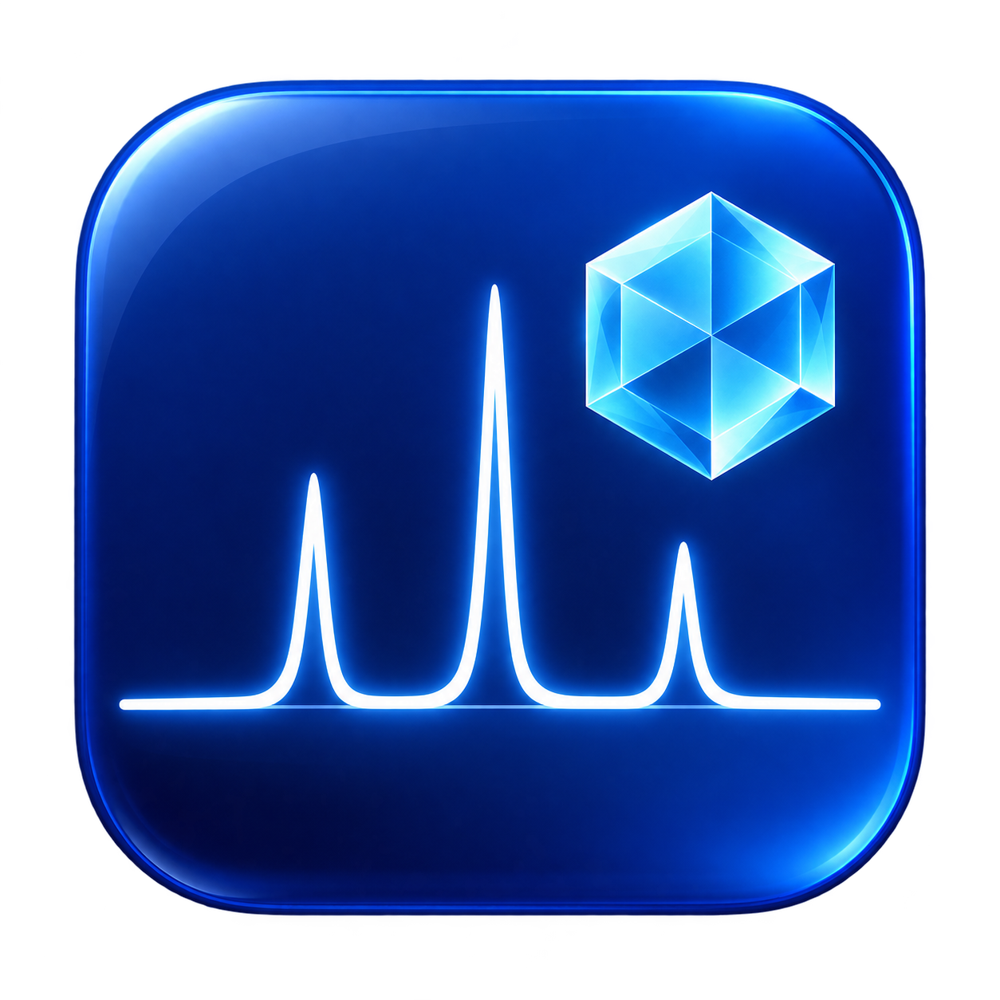

# XRD Plotter



A desktop tool for stacked X-ray diffraction plots on Windows and macOS.

## UV-Vis Plotter

The independent English-language UV-Vis application is in [uvvis/](uvvis/README.md).
It supports wavelength/absorbance limits, global or wavelength-range normalization,
per-spectrum visibility and export selection, configurable figure size and DPI,
and GitHub update checks. Download the Windows application from the
[UV-Vis 0.0.1 release](https://github.com/Greenbean0123/xrd-plotter/releases/tag/uvvis-v0.0.1).
UV-Vis releases use the `uvvis-v` tag prefix separately from XRD releases.

- Subtract the background and normalize each scan by its maximum corrected intensity.
- Import refinement CSV scans and PDF, CIF or XY references.
- Adjust colors, labels, visibility, plotting order, figure size and export resolution.
- Use Data, Layout and Settings tabs; colors live under Layout, while theme, UI scale and updates live under Settings.
- Export PNG, PDF, SVG and processed data.
- Cache parsed PDF references and show progress during startup.
- Check signed update manifests, download compatible updates and restart with rollback.

## Downloads

Get installers from [Releases](https://github.com/Greenbean0123/xrd-plotter/releases).
Standalone installers include Python and the required libraries.
Choose the Apple Silicon or Intel package matching your Mac.
Mac apps are currently ad-hoc signed, without Apple Developer ID notarization.

## Build from source

Use Python 3.13 with Tkinter. On Windows, run `Build-Windows.ps1`.
On a Mac, run `bash Build-Mac.command`; it checks and prepares the environment.
Outputs are written to `dist/`: an EXE on Windows or an app, DMG and update ZIP on Mac.

To run without packaging:

```sh
python -m pip install -r requirements-build.txt
python src/startup.py
```

The public repository includes synthetic demonstration data in `demo-data/`.
These are illustrations, not experimental data or validated reference standards.
Place your own files in a `defaultpattern` folder beside the installed executable
or Mac app, or add them in the interface. Original research files are not
included in the public source release.

## Input data

Sample CSV files require angle, observed intensity and background columns, such
as `twotheta,obs,background`. Samples are processed using
`(obs - background) / max(obs - background)` over the entire scan.
CIF references are calculated patterns; XY references use their first two columns.
PDF import supports the peak-table layout read by the parser, not arbitrary PDFs.

## Updates and development

See [Update-Publishing.md](Update-Publishing.md) for signing and publishing updates.
Only public verification keys are included in applications. The signing private
key is never published. Updates require confirmation before installation.

Tests: `python ci/test_updates.py`. Desktop startup/cache check:
`python ci/check_startup.py`. Mac build automation is in
`.github/workflows/build-macos.yml`.

## License

MIT; see [LICENSE](LICENSE). Third-party libraries retain their own licenses.
